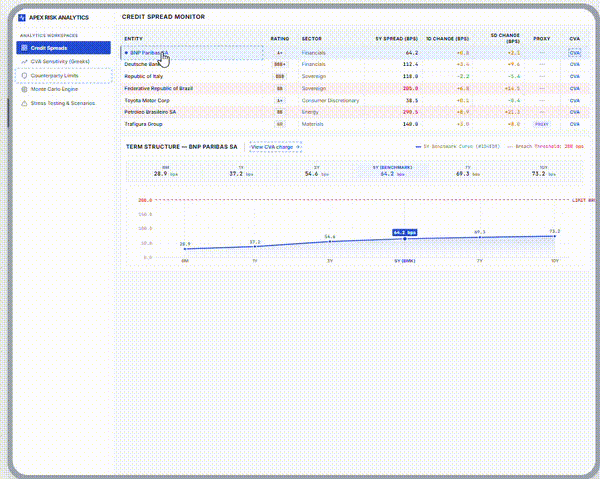
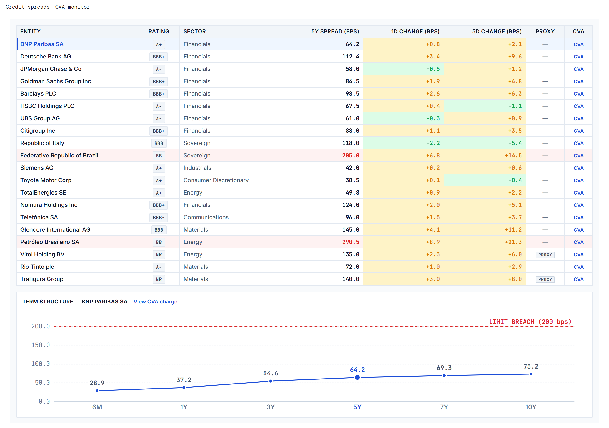
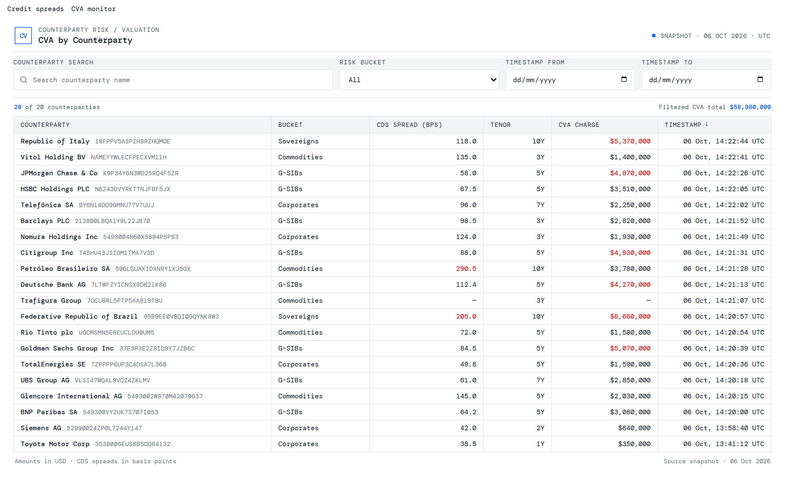
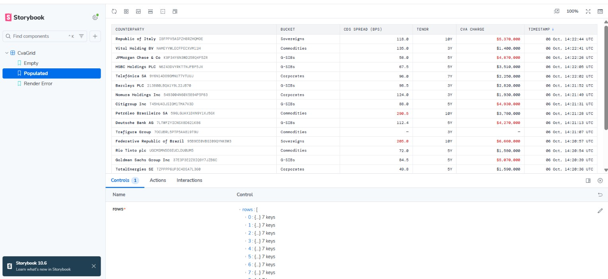
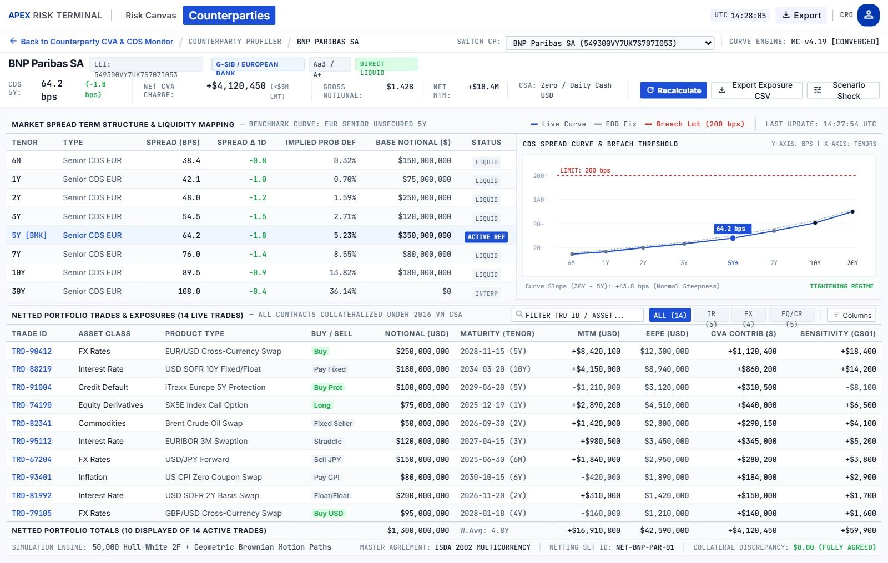

# CVA Dashboard: one AI tool per stage of the SDLC

A small CVA (credit valuation adjustment) monitoring dashboard, built as a guided tour through an AI-assisted software lifecycle: design, build, component test, e2e test, review, docs. One React app, one AI tool per stage, and a recorded reason for each choice.

  
   
  Stitch prototype click-through: credit spreads to CVA charge to counterparty drill-down (design prototype, not the built app).

**Domain:** CVA charge by counterparty, with CDS spreads as a pricing input. The same shape as a full-stack CVA UI built in React/C# in a past role, rebuilt here to show stage-appropriate tool selection, not CVA methodology. Spreads and charges are static mock data; there is no pricing engine.

**Look:** Bloomberg / AG Grid terminal density (26px rows, monospace right-aligned numerics, red only for breaches), not consumer SaaS.

## The screens

The built app (React + TypeScript, mock data), captured at 2x.

<table>
  <tr>
    <td width="50%"></td>
    <td width="50%"></td>
  </tr>
  <tr>
    <td align="center"><b>Credit spread monitor.</b> 5Y spread, 1D/5D change, PROXY flag, term structure for the selected name. Built in Module 7.</td>
    <td align="center"><b>CVA monitor.</b> Filterable CVA charge by counterparty. The CVA link on the credit screen lands here, pre-filtered.</td>
  </tr>
</table>

## From design to isolated component

  
   
  <b>Storybook.</b> <code>CvaGrid</code> isolated with Empty, Populated and Error stories, including null and stale-timestamp edge cases.

  
   
  <b>Stitch deep-dive (design only).</b> The first prompt over-scoped (two tables, engine telemetry). Naming exclusions and exact data fixed it on the next screen. Build is tracked in issue #34.

## The pipeline

| Stage | Tool | Why this tool | Output | Status |
|---|---|---|---|---|
| Design | **Stitch** (+ MCP into Claude Code) | Fast, dense UI from a prompt; design system file and a pullable design source | Mockups, `DESIGN.md`, 3 screens, A vs B hand-off comparison | Done |
| Build | **Replit Agent** | Spec-to-code with a structure and dataset I choose | React app in [`app/`](app/) | Done |
| Component test | **Storybook** | Exercise `CvaGrid` states without the full app | Empty / Populated / Error stories | Done |
| E2E test | **Playwright** | Assert user-visible behaviour: filter, click-through, breach flags | Tests in [`app/artifacts/cva-monitor/e2e/`](app/artifacts/cva-monitor/e2e/), each seen to fail first | Done |
| Review | **CodeRabbit** | AI review of a deliberately rough-edged PR | PR [#21](https://github.com/bleunguts/claude-ai-sdlc-cva-dashboard/pull/21) | **Blocked**: the bot never responded; cause unconfirmed |
| Docs | **Notion AI** | Turn build notes into a writeup, then fact-check it | [One-pager](docs/cva-dashboard-onepager.md) | Done |
| Wire-up | **Claude Code** | Carry the Stitch design into the running app | Credit screen routed to the CVA monitor | Done |

## What I learned

- **Asking for less gives cleaner output.** Naming what to change and what not to touch worked in Stitch, Replit and Notion alike.
- **A design system controls style, not scope.** Exact data plus explicit exclusions did.
- **A green build is not evidence.** Screenshots and deliberately broken tests are.
- **Tools edit by creating copies.** Pin and record the exact Stitch screen you built from.

The full prompt logs and retros are in [`app/PROMPTS.md`](app/PROMPTS.md) and [`design/README.md`](design/README.md). Module plan and status: [ROADMAP.md](ROADMAP.md).

## Live demo

[CVA monitor on Replit](https://cva-monitor-grid--bleunguts.replit.app/) (Module 2 build).

